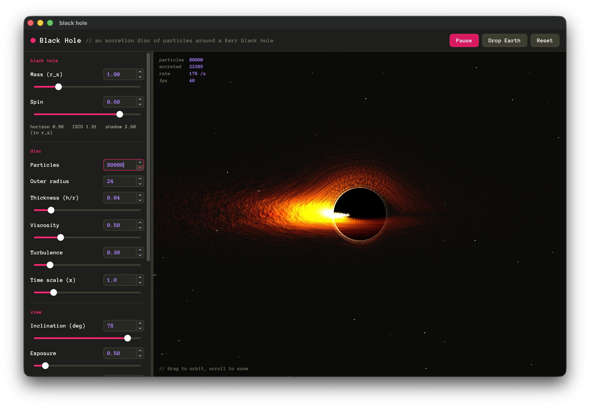

# black hole

A particle accretion disc around a spinning black hole, with gravitational lensing, Doppler beaming
and an Earth to drop in. Built on [raydom](https://github.com/ellimist-dev/raydom) and raylib.



```sh
just run      # configure, build and run
just serve    # build for the browser and serve it at http://localhost:8080
```

Without [just](https://github.com/casey/just): `cmake -S . -B build && cmake --build build`, then
`./build/black-hole-sim`.

## Requirements

- CMake 3.25 or newer.
- A C++20 compiler with `#embed`, which also builds raydom's C23:
  - macOS: Apple Clang 17, from Xcode 16.3 or later or its Command Line Tools.
  - Linux: Clang 19 or newer. GCC 15 has `#embed` too, but is untested.
  - Windows: untested.
- git and a network connection for the first configure, which downloads raydom (the tag pinned in
  `CMakeLists.txt`), raylib 6.0 through raydom unless one is installed, and the UI font.
- On Linux, raylib's X11 and OpenGL headers (on Debian and Ubuntu: `libx11-dev libxrandr-dev
  libxinerama-dev libxcursor-dev libxi-dev libgl1-mesa-dev`) and `libdbus-1-dev` for raydom's file
  dialogs. The sim doesn't use the dialogs; configure with `-DRAYDOM_FILE_DIALOG=OFF` to skip them.
- For the web build: Emscripten (built with 4.0.9), with `emcmake` on the PATH, and Go 1.27 for
  `just serve`.

`c++: error: unsupported option '--embed-dir=...'` means the compiler predates `#embed`
(`c++ --version` shows it). Update Xcode or the Command Line Tools, or use Homebrew's LLVM:

```sh
brew install llvm
rm -rf build  # CMake keeps the compiler from the first configure
CC=$(brew --prefix llvm)/bin/clang CXX=$(brew --prefix llvm)/bin/clang++ just build
```

## Controls

Drag the canvas to orbit the view and scroll to zoom. Space pauses, R resets, E drops the Earth.

Drag the controls' edge to resize them; drag it most of the way closed, double-click it, or press C to put
them away, and the tab on the canvas's edge (or C) brings them back. On a tall or narrow window the
controls sit below the canvas.

## How it works

`src/sim.cc` integrates test particles with leapfrog in the Paczynski-Wiita potential
-GM/(r - R), with R set so that the innermost stable orbit matches the Kerr ISCO for the spin.
Viscosity removes a fixed fraction of angular momentum per orbit, so the disc spirals in; particles
swallowed at the horizon respawn at the outer edge.

`src/render.cc` images them on a raydom canvas: temperature falls as r^-3/4, beaming scales
brightness as D^2.2, gravitational redshift dims the inner disc, and material behind the hole is
lensed as by a point mass. Particles draw into two fading render textures, behind and in front of
the shadow, which gives trails.

`src/ui.cc` is the raydom interface, and `src/theme.cc` restyles raydom_extras' controls in Monokai.

## Web

`just web` builds `build-web/black-hole-sim.js` with Emscripten (`emcmake` on the PATH): one
self-contained script with the WebAssembly embedded, about 1.4 MB. Include it in any page with
`<script src="black-hole-sim.js"></script>`; it uses a `<canvas id="canvas">` if the page has one and
otherwise adds a canvas filling the window. The canvas follows the window's size, so the layout
switches to controls-below on a phone, and renders at the display's pixel density.

`just serve` also copies `web/index.html` next to it and serves both with the small Go server in
`serve/` (Go 1.27) at http://localhost:8080. The link runs at `-O1`, which skips the passes that
need Emscripten's npm packages; the code itself is compiled at `-O3`.
